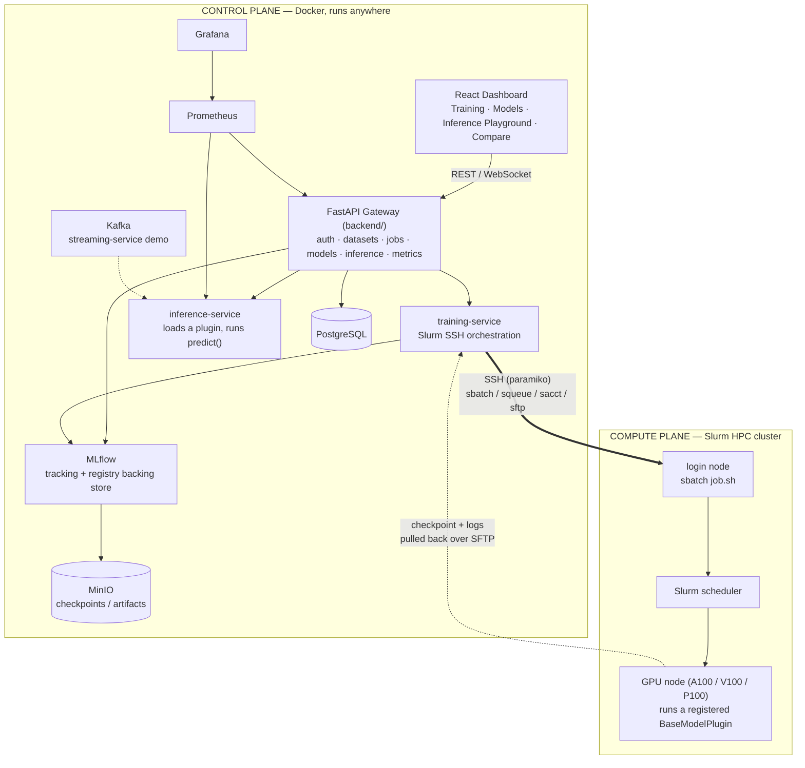

# MLOpsForge

**A model-agnostic ML infrastructure platform** - train, track, register, deploy, and monitor any PyTorch model
on a Slurm/HPC GPU cluster, controlled entirely from a web dashboard.

> "I built reusable ML infrastructure. SAMamba is one of the supported workloads used to demonstrate it."

**[🔗 Live demo](https://frontend-pi-gilt-10.vercel.app)** - a real, running deployment, not a screenshot. The
backend lives on a university HPC cluster reached through a tunnel that's only up while actively demoed; if the
link shows a login page that never loads past that, the tunnel isn't running at that moment - see
[Known Limitations](#known-limitations).

Every capability described in this README is backed by an actual run against real infrastructure, a real
Slurm HPC cluster, a real MLflow server, real Prometheus/Grafana, a real Kafka broker — not a mock or a script
that was written but never executed. See [`docs/ROADMAP.md`](docs/ROADMAP.md) for the full, dated verification
history, including the real bugs found and fixed along the way.

## In plain English

Most student ML projects look like a single script: load a dataset, train one model, print an accuracy number.
This is a different kind of project it's the **infrastructure a real ML platform team builds around many
models**, not a model itself. Concretely: a web dashboard where you register a dataset, click "submit training
job," and that job actually runs on a shared university GPU cluster through the same scheduler (Slurm) real
HPC centers use not your laptop, not a rented cloud GPU. Every run gets tracked (what config, what metrics,
what checkpoint), trained models get versioned and can be promoted to "production," and you can then get live
predictions out of any of them from the same dashboard. It's the same *shape* of system as things like AWS
SageMaker or Google Vertex AI, built from scratch to understand how those systems actually work under the
hood and it's deliberately **model-agnostic**: it doesn't just run one model, it runs three genuinely
different ones (a real published graph/AI-research architecture called SAMamba, a from-scratch GNN, and an
image classifier) through the exact same pipeline, which is the whole point.

## Architecture

MLOpsForge is split into a **control plane** (stateless-ish services you run anywhere with Docker) and a
**compute plane** (a Slurm HPC cluster, reached over SSH). This mirrors how real organizations run a cloud/
on-prem control plane against an HPC GPU cluster they don't fully control — it's also a hard constraint of the
dev environment this was built in (see [`docs/ENVIRONMENT.md`](docs/ENVIRONMENT.md)).



Full component-by-component breakdown: [`docs/ARCHITECTURE.md`](docs/ARCHITECTURE.md). Design rationale and
data flows: [`docs/SystemDesign.md`](docs/SystemDesign.md).

## GIF

> _TODO: a ~15s looping GIF of the golden path (submit a job → watch it go QUEUED → RUNNING → FINISHED →
> appears in Models) is the highest-value thing to add here it's what a reader sees before they decide
> whether to keep scrolling. Record a screen capture of the Training page, trim to the state transitions, and
> convert with something like `ffmpeg -i demo.mov -vf "fps=12,scale=960:-1" docs/media/demo.gif`, then embed
> it right here with ``._

## Demo Video

> _TODO: 3–5 minute walkthrough — Login → Register Dataset → Create Experiment → Submit Training → watch the
> real Slurm job → MLflow run → Model Registry → Inference Playground → Compare Runs → Grafana dashboard.
> Upload to YouTube, then embed here:_
>
> `[](https://youtube.com/watch?v=YOUR_VIDEO_ID)`

## Screenshots

> _TODO: 3–4 screenshots that carry the most signal the Training page mid-job, a real Grafana dashboard with
> live data, the Inference Playground's digit canvas + prediction, and the Compare page. Save under
> `docs/media/` and embed with ``._

## Features

- **Model-agnostic training** - any PyTorch model that implements `BaseModelPlugin` gets Slurm submission,
  MLflow tracking, and a registry entry for free. Proven with three structurally different plugins, not one:
  - `samamba` - the real, published SAMamba architecture (GAT + Mamba SSM), transductive graph node
    classification on a 30k-node / 1.27M-edge Ethereum phishing/scam graph
  - `gcn_baseline` - a from-scratch GCN on the Cora citation network
  - `mnist_cnn` - a CNN on MNIST, deliberately CPU-only to prove the platform honors heterogeneous
    per-plugin resource requests, not just "always ask for a GPU"
- **Real Slurm HPC orchestration** — SSH (paramiko) to a login node, templated `sbatch` scripts, `squeue`/
  `sacct` polling, checkpoints pulled back over SFTP. Per-plugin resource overrides including a dedicated
  Python interpreter and GPU model pinning (see [Slurm Architecture](#slurm-architecture)).
- **Experiment tracking & model registry** via MLflow, with a promotion workflow (`none → staging →
  production → archived`) layered on top.
- **Live Inference Playground** - pick a registered model, feed it real input (including a drawable canvas for
  the digit classifier), get a real prediction back from `inference-service`.
- **Monitoring** - hand-rolled Prometheus metrics (`mlopsforge_job_queue_depth`, `mlopsforge_job_duration_seconds`,
  `mlopsforge_inference_latency_seconds`, ...) and a provisioned Grafana dashboard, not a generic
  auto-instrumentation firehose.
- **Live job status** over WebSocket, with a polling fallback — no manual refresh to watch a job progress.
- **Streaming inference demo** - a Kafka producer/consumer pair scores real transactions through the actual
  authenticated inference API, proving the path is fast enough for near-real-time use (39–163ms/transaction,
  measured).
- **Multi-run comparison** - select any finished jobs across different plugins and compare config + live
  MLflow metrics side by side, even with heterogeneous metric keys.
- **Auth** - JWT-based, every route gated except health/auth/the internal Slurm status callback.

## System Design

The full design document - problem statement, requirements, training/inference flow diagrams, and the
reasoning behind every major technology choice (why plugins, why MLflow, why Slurm, why FastAPI, why Kafka,
why per-plugin conda environments) lives in [`docs/SystemDesign.md`](docs/SystemDesign.md). The two flows
that matter most:

**Training**: `Frontend → Backend → training-service → Slurm → GPU node → MLflow → Model Registry`
**Inference**: `User → Backend → inference-service → Plugin.predict() → checkpoint → prediction`

## How it works

```
POST /api/v1/jobs {plugin: "samamba", dataset_version_id: 7, config: {...}}
  → backend validates config against the plugin's JSON-Schema config, creates a Job row (status=QUEUED)
  → backend calls training-service's internal API
  → training-service renders an sbatch script from the plugin's resource declaration, SSHes to the
    HPC login node, runs sbatch → gets back a real slurm_job_id
  → training-service updates the Job row; backend broadcasts the new status to every connected
    WebSocket client
  → frontend's WebSocket client shows QUEUED → RUNNING as squeue reflects the real cluster state
  → on Slurm completion, training-service pulls the checkpoint + logs back over SFTP, logs final
    metrics to MLflow, sets Job status=FINISHED
  → the run appears in Experiments with live MLflow metrics; the checkpoint appears in Models as a
    candidate version, pending manual promotion
  → from there, POST /inference/predict/{model_version_id} (or the Inference Playground) resolves the
    model version into a plugin + checkpoint path and calls plugin.predict() for real
```

## Plugin Architecture

The platform never imports a model-specific module — everything it knows about any given model comes through
one contract, [`plugins/base/interface.py`](plugins/base/interface.py):

```python
class BaseModelPlugin(ABC):
    name: str
    version: str
    task_type: str

    def get_config_schema(self) -> dict: ...      # JSON Schema -> rendered as a form in the UI
    def train(self, dataset_path: str, config: dict, output_dir: str) -> TrainResult: ...
    def evaluate(self, model_path: str, dataset_path: str, config: dict) -> dict[str, float]: ...
    def predict(self, model_path: str, inputs: Any) -> Any: ...
```

Adding a new model means adding a new plugin directory — zero changes to `backend/` or `training-service/`.
Each plugin ships its own `plugin.yaml` (config schema + default Slurm resources) and is loaded dynamically at
runtime via `plugins.base.registry.load_plugin(entrypoint)`, never imported directly by name. This is why the
platform could absorb a workload as different as SAMamba (a real research architecture with its own CUDA
extensions) without touching a single line of `backend/` or `training-service/` core logic.

## Slurm Architecture

`training-service` is the one place SSH credentials to the HPC cluster live (`training-service/app/slurm_client.py`),
using a dedicated keypair, never a personal one. Given a job request, it:

1. Looks up the plugin's entrypoint and Slurm resource defaults (`plugins/<name>/plugin.yaml`)
2. Renders a job script from a Jinja2 template (`training-service/slurm_templates/train_job.sh.j2`)
3. SFTPs the script + resolved config JSON to the login node, runs `sbatch`, captures the real `slurm_job_id`
4. Polls `squeue`/`sacct` to track `QUEUED → RUNNING → FINISHED | FAILED | CANCELLED`
5. On completion, SFTPs checkpoints/logs back and writes final metrics into MLflow

Two resource overrides exist because the real SAMamba plugin needed them, and both are general, any future
plugin can use them, not just samamba:

- **`python_bin`** - a plugin can declare its own Python interpreter (e.g. a dedicated conda env), instead of
  the shared training-service venv. Needed because `mamba-ssm`'s compiled CUDA kernels shouldn't be forced into
  the environment every other plugin's job relies on.
- **`gpu_type`** - a plugin can pin a specific GPU model (`--gres=gpu:<type>:<n>`), instead of whatever the
  partition happens to schedule. Needed because this cluster's `cse-gpu-all` partition spans physically
  different GPUs (A100/V100/P100), and `mamba-ssm`'s precompiled kernels don't include Pascal (sm_60) — the
  first real submission landed on a P100 and failed with `no kernel image is available for execution on the
  device` before this was added.

A real race condition was found and fixed here too: Slurm can report a job `COMPLETED` slightly before its
last writes (a large checkpoint especially) are visible over the same SFTP connection. The reconciler now
retries briefly before finalizing a "finished" transition, instead of silently stranding the job with no
checkpoint or metrics.

## Tech Stack

| Layer                | Technology |
|-----------------------|------------|
| Frontend              | React, TypeScript, Vite, TailwindCSS, TanStack Query |
| Backend gateway       | FastAPI, Pydantic v2, SQLAlchemy 2.0, Alembic |
| Database              | PostgreSQL |
| Training compute      | PyTorch, Slurm (real HPC cluster), submitted via SSH (paramiko) |
| Experiment tracking   | MLflow |
| Object storage        | MinIO (S3-compatible) |
| Streaming             | Apache Kafka (KRaft mode) |
| Monitoring            | Prometheus + Grafana |
| Inference             | FastAPI + Torch |
| Containerization      | Docker Compose (control plane only — compute plane is bare-metal Slurm) |

### Capabilities at a glance

```
✓ Image classification        (mnist_cnn)
✓ Graph node classification   (gcn_baseline, samamba)
✓ State-space model inference (real Mamba SSM, real CUDA kernels)
✓ CPU-only training           (mnist_cnn: gpus: 0)
✓ GPU training                (gcn_baseline, samamba: real A100/V100/P100)
✓ Real Slurm HPC scheduling   (sbatch / squeue / sacct over SSH)
✓ Experiment tracking         (MLflow)
✓ Model registry & promotion  (none → staging → production → archived)
✓ Live inference              (Inference Playground, streaming-service)
✓ Streaming scoring           (Kafka producer/consumer)
✓ Monitoring & dashboards     (Prometheus + Grafana)
✓ Live job status             (WebSocket)
✓ Multi-run comparison        (heterogeneous metrics across plugins)
```

## Project Structure

```
MLOpsForge/
├── backend/            FastAPI control-plane API: auth, datasets, experiments, jobs, models, inference, metrics
├── plugins/            Model plugin implementations (BaseModelPlugin contract): samamba, gcn_baseline, mnist_cnn
├── training-service/   Slurm orchestration: job templates, SSH client, sbatch/squeue/sacct polling
├── inference-service/  Loads a registered model via its plugin and serves predictions over REST
├── streaming-service/  Kafka producer/consumer demo: near-real-time transaction scoring via the inference API
├── sdk/                Python client SDK — how a plugin author or script talks to the platform
├── frontend/           React + TypeScript dashboard, including the Inference Playground
├── infra/              docker-compose stack: Postgres, Redis, Kafka, MLflow, MinIO, backend, Prometheus, Grafana
├── scripts/            Dataset prep + onboarding scripts (Cora, MNIST, the real EPTransNet graph, ...)
├── datasets_registry/  Local dataset staging area (gitignored; real data lives here or in MinIO)
└── docs/               Architecture, system design, roadmap, environment notes
```

## Known Limitations

Documented rather than hidden - see the linked READMEs for the full detail on each:

- **`docker compose up` is written but unrun.** No Docker in this dev environment. Every service the compose
  file wires together *is* verified individually as a bare process - see [`infra/README.md`](infra/README.md).
- **`inference-service` can't yet serve real SAMamba predictions.** Its shared venv lacks `torch_geometric`,
  and the real Mamba kernels need CUDA even at inference time, which that (deliberately non-GPU) control-plane
  service doesn't have. `plugin.predict()` itself is verified correct directly against real checkpoints — see
  [`inference-service/README.md`](inference-service/README.md).
- **Triton Inference Server was deliberately not built.** Docker-only distribution, unverifiable in this
  Docker-less dev environment — writing the integration without being able to run it would just be more
  "written, not verified" surface area.
- **Redis is declared but unused.** The originally-planned job-status pub/sub ended up built differently (an
  in-process WebSocket broadcast, correct for today's single-process deployment) — see `docs/ARCHITECTURE.md`.

## Future Work

- **Explainability** - attention/subgraph visualization for SAMamba predictions.
- **GPU-backed inference for real Mamba checkpoints** - either a subprocess-per-plugin-interpreter redesign
  for `inference-service` (mirroring what `training-service` already has), or a small GPU-backed inference
  deployment, to close the known limitation above.
- **`docker compose up` verification** - the moment this runs on a machine with Docker, this becomes the
  natural way to hand the repo to someone else.
- **Full SAMamba protocol run** - `max_folds`/`n_splits`/`epochs` are already config knobs; reproducing the
  paper's full 3×-repeated 3-fold / 1000-epoch protocol is one config change away, at real compute cost.

## License

MIT — see [LICENSE](LICENSE).
