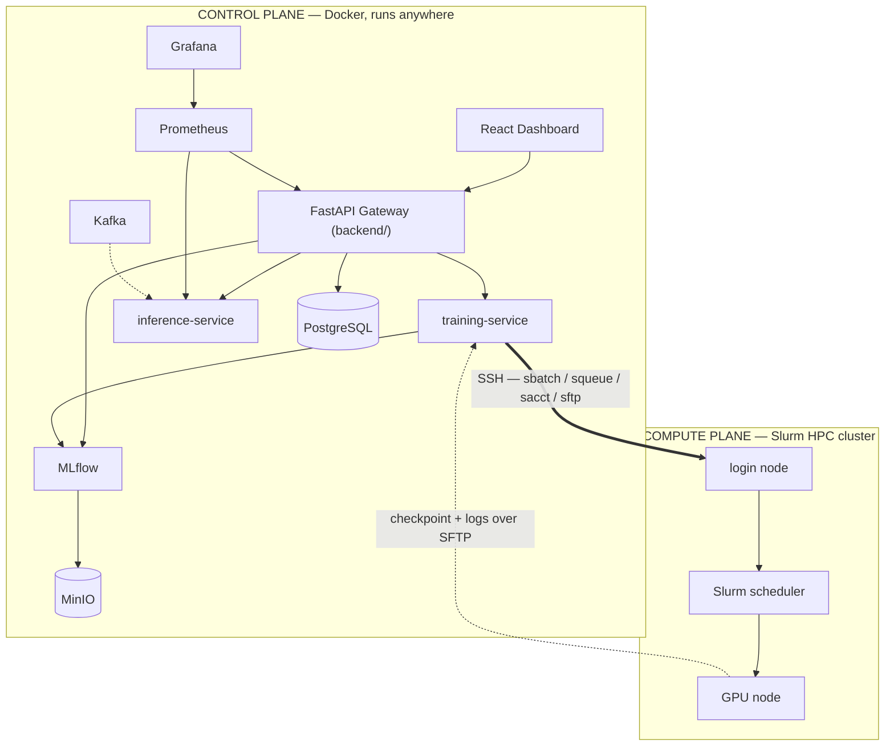

# System Design

## Problem

Research code and production infrastructure solve different problems, and conflating them is where most
"we trained a model" projects stop short. `train_phish_scam.py` — the real, published SAMamba entry point this
platform now runs — is a good concrete example of what research code optimizes for and what it doesn't:

- **A single script, a single machine.** Paths are hardcoded (`./datasets_phish_scam/...`), the device is
  whatever's in `CUDA_VISIBLE_DEVICES` on the machine you happen to be on, and there's no way to run it
  anywhere else without editing the script.
- **No versioning.** Which checkpoint came from which config, which dataset version, which git commit — none
  of that is tracked. `torch.save({'args': args, 'state_dict': ...}, ...)` is the entire experiment tracking
  story.
- **No serving path.** The model exists as a `.pth` file. Turning it into something a second system can call
  is a separate, unstarted project.
- **No multi-user, no multi-model story.** The script *is* the model. A second model means a second script
  with its own copy-pasted training loop, its own copy-pasted checkpoint format, its own copy-pasted argparse.
- **No operational visibility.** Progress is `print()` statements. There's no queue, no history, no dashboard,
  no alerting if a run silently fails three hours in.

None of this is a criticism of the research code — it did exactly its job, which was producing the paper's
results. The problem MLOpsForge solves is the *next* problem: what does it take to run that same model (and
others) as a service that a team, not just its author, can submit jobs to, track, compare, register, and query
predictions from, on compute neither the author nor the caller directly controls.

## Requirements

| Requirement | What it means here |
|---|---|
| **Multi-model** | Any PyTorch model can be onboarded by implementing one interface (`BaseModelPlugin`) — no changes to the platform itself. Proven with three structurally different plugins: a real published graph/SSM architecture, a from-scratch GCN, and a CNN. |
| **Multi-user** | JWT auth on every route; datasets/experiments/jobs are tagged with an owner. (Per-user *visibility* restriction — hiding other users' resources — is explicitly out of scope; see Known Limitations in the README.) |
| **HPC compute** | Training runs as real Slurm jobs on a real GPU cluster, submitted over SSH — not a local GPU, not a cloud VM API. |
| **Tracking** | Every run's config, metrics, and checkpoint are recoverable after the fact via MLflow, keyed by job id. |
| **Monitoring** | Live operational visibility (queue depth, job duration, inference latency) via Prometheus + Grafana, not just experiment-level metrics. |
| **Registry** | A checkpoint becomes a queryable, stage-managed artifact (`none → staging → production → archived`), not just a file on disk. |

## Architecture

See the diagram in the [top-level README](../README.md#architecture) — reproduced here for reference:



The control-plane/compute-plane split is the central architectural decision. Everything above the SSH boundary
is stateless-enough to run anywhere with Docker; everything below it is bare-metal Slurm the platform doesn't
own or control. That boundary is exactly where real organizations draw it when they don't run their own GPU
cluster's scheduler — which is why this shape, not incidentally.

## Training Flow

```
Frontend
  │  POST /api/v1/jobs { plugin, dataset_version_id, config }
  ▼
Backend
  │  validates config against the plugin's JSON-Schema, creates a Job row (QUEUED),
  │  calls training-service's internal API
  ▼
Training Service
  │  renders an sbatch script from the plugin's declared resources (partition, gpus,
  │  gpu_type, python_bin, ...), SFTPs it + the resolved config to the login node
  ▼
Slurm
  │  sbatch → real slurm_job_id; scheduler places the job on a matching node
  ▼
GPU node
  │  runs `python -m plugins.base.run_train` → dynamically loads the plugin →
  │  plugin.train() → writes checkpoint.pt + result.json
  ▼
MLflow
  │  training-service pulls the checkpoint back over SFTP, logs params/metrics/
  │  checkpoint as a real MLflow run
  ▼
Registry
     a finished job's checkpoint can be promoted to a versioned, stage-managed
     model — from there it's servable via the Inference Playground or the API
```

Status changes at every step are broadcast over WebSocket, so the frontend shows `QUEUED → RUNNING → FINISHED`
as `squeue`/`sacct` actually report it — not a polling guess.

## Inference Flow

```
User
  │  picks a registered model version + fills in its plugin-specific input shape
  ▼
Inference API
  │  POST /api/v1/inference/predict/{model_version_id} — resolves the model version
  │  into { plugin_entrypoint, checkpoint_path } server-side; the caller never
  │  needs to know either
  ▼
Plugin
  │  inference-service dynamically loads the same plugin training used, calls
  │  plugin.predict(checkpoint_path, inputs)
  ▼
Checkpoint
  │  the plugin loads its own checkpoint format (state dict + whatever metadata
  │  it needs to reconstruct itself — e.g. samamba's checkpoint also carries the
  │  trained graph tensors, since it's transductive)
  ▼
Prediction
     real model output, shaped however that plugin defines it (a class + softmax
     distribution, a fraud probability, ...) — returned to the caller
```

`inference-service` is a separate process from `backend` specifically so the backend never needs `torch`,
`sklearn`, or any plugin's runtime dependencies installed — a caller only ever needs a model version id.

## Design Decisions

**Why plugin architecture, not one training script per model?**
Because the alternative is what the research code already looked like — a copy-pasted training loop per model.
`BaseModelPlugin` fixes the *contract* (config schema, train, evaluate, predict) and leaves everything else —
architecture, loss, data format, even the checkpoint's internal shape — up to the plugin. The platform (backend,
training-service) never imports a model-specific module; it only ever calls through the interface via
`plugins.base.registry.load_plugin(entrypoint)`. This is what let the real SAMamba architecture (with its own
CUDA extensions and a completely different data shape — a fixed graph, not row-per-sample) get absorbed without
touching platform code.

**Why MLflow, not a hand-rolled tracking table?**
Experiment tracking is a solved problem with a well-understood API (`log_param`/`log_metric`/`log_artifact`,
a REST API, a UI). Building a bespoke version would mean re-solving run comparison, artifact storage, and a
query API that MLflow already gets right. What MLflow *doesn't* model — which plugin, which Slurm job, which
dataset version produced a run — is exactly the thin layer `backend/`'s `/experiments` and `/models` routers add
on top.

**Why Slurm, not a cloud GPU API (or just a local GPU)?**
Because that's the real constraint this was built under and the realistic constraint a lot of ML infra actually
runs under: an HPC cluster the platform doesn't own, reached over SSH, shared with other users' jobs, with
heterogeneous hardware (this cluster alone spans A100/V100/P100 nodes). Designing for "submit a job to a
scheduler you don't control and poll for its result" generalizes better than designing for "call an API that
hands you a GPU on demand" — and it's what surfaced real, non-obvious problems (the GPU-architecture kernel
mismatch, the SFTP-visibility race condition) that a simpler local-GPU design would never have hit.

**Why FastAPI for the gateway?**
Pydantic-validated request/response schemas map directly onto the plugin config-schema validation this
platform already needs to do (validate a job's config against its plugin's JSON Schema before ever reaching
Slurm), native async support for the WebSocket broadcast path, and OpenAPI docs for free.

**Why Kafka for the streaming demo, not just more REST calls?**
Because "is the inference path fast enough for near-real-time scoring" is a different question than "does the
inference API work," and answering it honestly needs an actual streaming topology — a producer simulating a
live feed, a consumer scoring through the same authenticated API anything else uses, no shortcut that bypasses
the platform to go faster. Measured 39–163ms per transaction this way, not estimated.

**Why Prometheus + Grafana, not just MLflow's own metrics?**
MLflow metrics are per-run, logged once at training completion — they answer "how did this training run go."
Prometheus/Grafana answer a different, *operational* question: "how is the platform doing right now" (queue
depth, job duration distribution, live inference latency). Hand-rolled `prometheus_client` metrics rather than
auto-instrumentation, so `/metrics` exposes exactly the platform-specific signals that matter instead of a
generic HTTP-request firehose.

**Why does `samamba` get its own conda environment instead of installing into the shared venv?**
`mamba-ssm`/`causal-conv1d` ship compiled CUDA kernels built against a specific CUDA toolkit and set of compute
capabilities. Forcing every plugin's Slurm job to carry those dependencies — and their exact-version pins —
would make the shared environment fragile for the three plugins that don't need them at all. The
`python_bin`/`gpu_type` resource overrides (see the README's Slurm Architecture section) exist specifically so
one plugin's unusual requirements don't leak into the platform's baseline.
